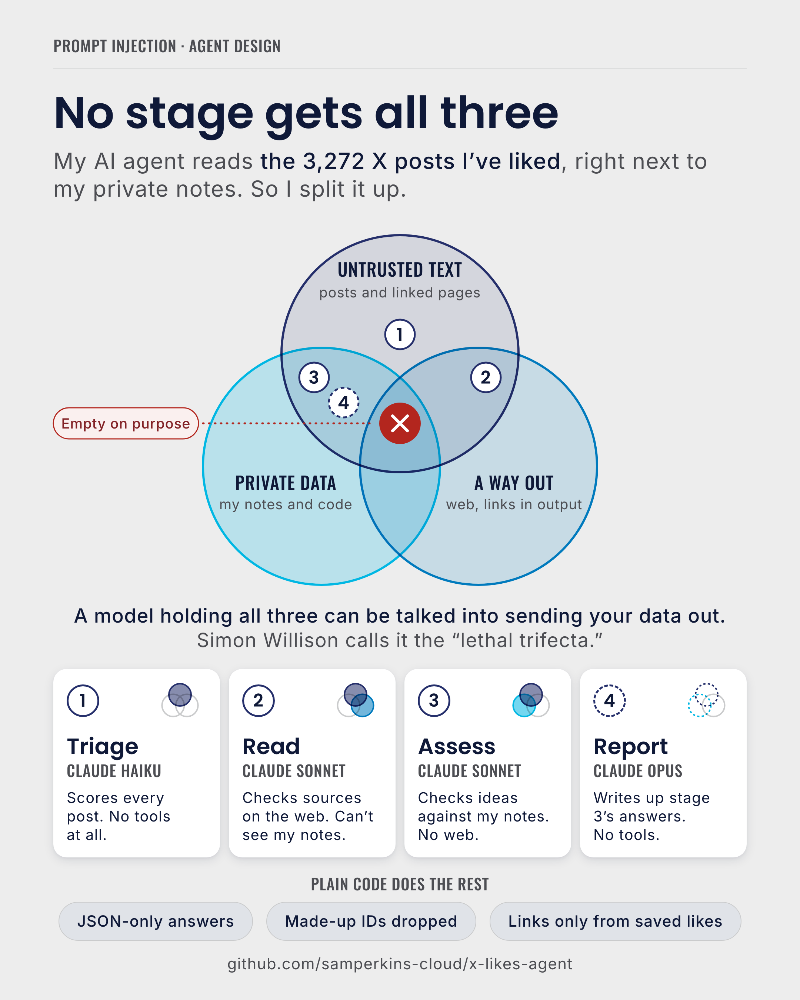

# x-likes-agent

An AI agent that reads every post you've liked on X. It checks the useful ones against their sources and against your own notes and code, then writes you a short review of what's worth acting on.

It reads those X posts right next to your private notes. So it's split into four stages, and no stage gets all three of: untrusted text, your private data, and a way to send data out.



## Why it's built this way

An agent that holds untrusted text, private data and a way to send data out can be talked into leaking that data. Simon Willison calls this the [lethal trifecta](https://simonwillison.net/2025/Jun/16/the-lethal-trifecta/). Every stage here is missing at least one of the three:

| Stage | Model | Tools | Sees posts | Sees your notes | Web |
|---|---|---|---|---|---|
| Triage | Claude Haiku | none | yes | no | no |
| Read | Claude Sonnet | WebFetch, WebSearch | yes | no | yes |
| Assess | Claude Sonnet | Read, Grep, Glob | yes | yes | no |
| Report | Claude Opus | none | via assess | via assess | no |

Plain code handles the rest:

- Every model answers in JSON against a fixed schema, and only the script writes files.
- Each post goes into the prompt inside a tag with a random suffix, with its angle brackets swapped out, so a post can't close its own block.
- Post IDs a model makes up are dropped.
- Links, images and HTML are stripped from model text. Every link in the report is built from your saved likes.
- Each call runs Claude Code with no settings, hooks or MCP servers loaded (`--setting-sources ""`, `--strict-mcp-config`). No stage can read `.env` files, `.git` or the other paths in `NO_READ`.

This is tool-level isolation inside Claude Code, not an OS sandbox. The assess stage can read anything in the notes folder you give it, apart from the blocked paths, so give it a folder you're comfortable with a model reading.

## What you need

- Python 3.9 or later. Standard library only.
- [Claude Code](https://claude.com/claude-code), installed and signed in. The script calls `claude` in print mode.
- Your X archive: Settings → Your account → Download an archive of your data. X emails you when it's ready.

## Setup

```
git clone https://github.com/samperkins-cloud/x-likes-agent
cd x-likes-agent
cp profile.example.md profile.md
```

Then fill in `profile.md`. Every stage reads it to know who you are, what you've built and what you want to get better at, so keep it short and factual.

## Run it

```
python3 x_likes.py import ~/Downloads/twitter-YYYY-MM-DD-xxxx.zip
python3 x_likes.py run --notes ~/notes
```

`--notes` (or `X_LIKES_NOTES`) is the folder the assess stage checks ideas against: your notes, docs or a code repo.

The review lands in `data/reports/x-likes-review-YYYY-MM-DD.md`. Each stage saves as it goes and skips finished work, so a run that stops partway picks up where it left off, and later runs only cover new likes.

Other commands:

- `status`: counts per stage
- `shortlist`: what the deep stages would take
- `triage`, `read`, `assess`, `report`: one stage at a time
- `report --again`: rebuild the last report

## Cost

My first full run, about 3,200 likes going back to 2016, came to about $11 at API list prices. Triage on Haiku is the cheap part. The deep stages only see the shortlist, at most 70 posts per run.

## Settings

| Variable | Default | What it does |
|---|---|---|
| `X_LIKES_NOTES` | none | Folder the assess stage reads |
| `X_LIKES_DATA` | `./data` | Ledger, stage results and reports |
| `X_LIKES_PROFILE` | `./profile.md` | Who you are, for every stage |
| `X_LIKES_NO_READ` | none | More paths to block in the notes folder, comma-separated, such as `secrets/**,logs/**` |
| `X_LIKES_TRIAGE_MODEL`, `X_LIKES_READ_MODEL`, `X_LIKES_ASSESS_MODEL`, `X_LIKES_REPORT_MODEL` | Haiku, Sonnet, Sonnet, Opus | Model per stage |
| `CLAUDE` | `claude` on your PATH | The Claude Code binary |

The topics live in `TOPICS` near the top of `x_likes.py`. Change them to fit what you like.

## Limits

- It reads post text only. Images, video and the rest of a thread aren't seen.
- X's archive has no author names or expanded links, so for those likes the source check relies on search.
- Source checks only cover the shortlist.

## Tests

```
python3 test_x_likes.py
```

They cover import, the injection defences and the shortlist, with no model calls and no network.

Built with Claude Code. MIT license.
